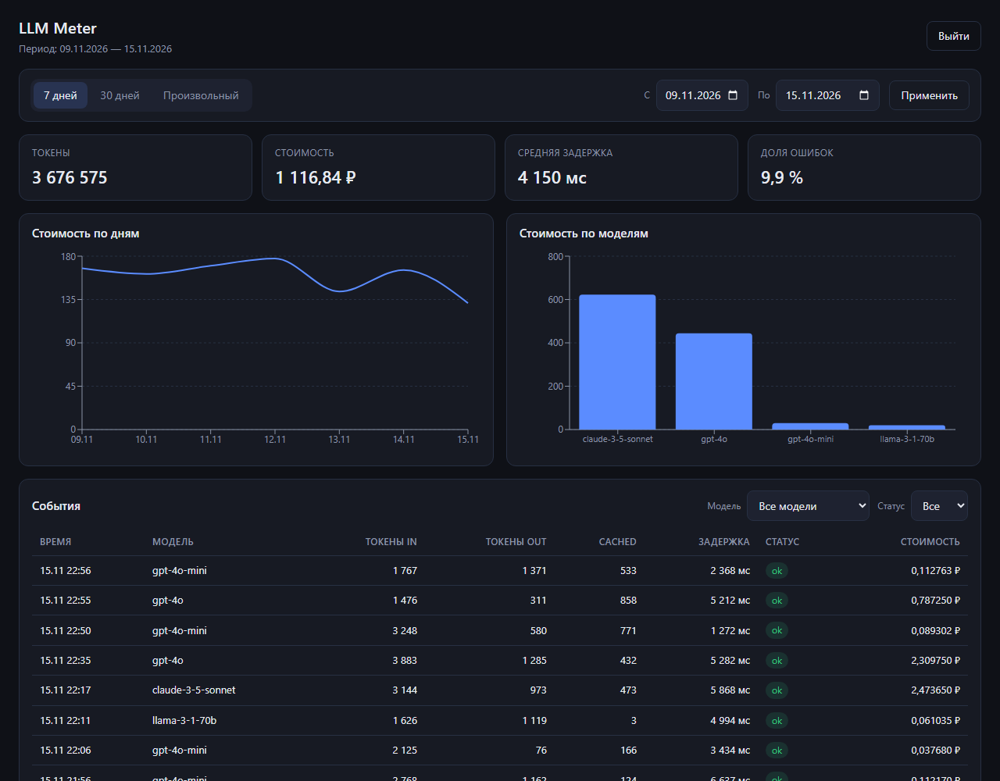

# llm-meter

Бэкенд сервиса наблюдаемости LLM-агентов: приём событий вызовов моделей, расчёт стоимости в рублях, выборка событий и агрегированная статистика.

Стек: TypeScript, Node 22, Fastify 4, PostgreSQL 16, `pg` (чистый SQL), `@fastify/jwt`, `bcryptjs`. ORM нет, миграции — обычные `.sql` файлы.



Дашборд показывает: карточки с ключевыми метриками (токены, стоимость, средняя задержка, доля ошибок), график стоимости по дням, график расходов по моделям и таблицу событий с фильтрами по модели и статусу и пагинацией по 50 записей.

## Схема БД

`models` — справочник моделей и цены (рубли за 1M токенов):

| колонка | тип | примечание |
| --- | --- | --- |
| id | serial PK | |
| name | text UNIQUE NOT NULL | имя модели, по нему ищется модель при приёме событий |
| price_in_per_m | numeric(12,4) NOT NULL DEFAULT 0 | цена входных токенов |
| price_out_per_m | numeric(12,4) NOT NULL DEFAULT 0 | цена выходных токенов |
| price_cached_per_m | numeric(12,4) NOT NULL DEFAULT 0 | цена кэшированных токенов |

`llm_events` — события вызовов:

| колонка | тип | примечание |
| --- | --- | --- |
| id | uuid PK DEFAULT gen_random_uuid() | |
| event_id | text UNIQUE NOT NULL | идемпотентность приёма |
| ts | timestamptz NOT NULL | время события |
| model_id | int NOT NULL REFERENCES models(id) | |
| tokens_in | int NOT NULL DEFAULT 0 | |
| tokens_out | int NOT NULL DEFAULT 0 | |
| cached_tokens | int NOT NULL DEFAULT 0 | |
| latency_ms | int NOT NULL DEFAULT 0 | |
| status | text NOT NULL | `ok` / `error` |
| cost_rub | numeric(12,6) NOT NULL DEFAULT 0 | считается на вставке |
| task_id | text | |
| meta | jsonb | |

Индексы: `idx_llm_events_ts (ts)`, `idx_llm_events_model_id (model_id)`, плюс уникальный индекс по `event_id` из самого ограничения `UNIQUE`.

Служебная таблица миграций: `schema_migrations(name text PRIMARY KEY, applied_at timestamptz DEFAULT now())`.

## Ручки

Все ручки, кроме `/health` и `/auth/login`, требуют заголовок `Authorization: Bearer <token>`.

### POST /auth/login

```bash
curl -s -X POST http://localhost:3000/auth/login \
  -H "Content-Type: application/json" \
  -d '{"login":"admin","password":"admin"}'
# {"token":"eyJ..."}
```

Неверные данные → `401 {"error":"invalid credentials"}`.

### POST /ingest

Тело — массив событий или один объект. Обязательные поля: `event_id`, `ts`, `model`, `status`; числа опциональны (по умолчанию 0), `task_id` — строка или null.

```bash
TOKEN=... # из /auth/login
curl -s -X POST http://localhost:3000/ingest \
  -H "Authorization: Bearer $TOKEN" \
  -H "Content-Type: application/json" \
  -d '[
    {"event_id":"e-1","ts":"2026-11-01T10:00:00Z","model":"gpt-4o-mini",
     "tokens_in":1200,"tokens_out":300,"cached_tokens":0,"latency_ms":850,"status":"ok","task_id":"task-1"}
  ]'
# {"received":1,"inserted":1,"duplicates":0}
```

Повторная отправка тех же `event_id` → `{"received":1,"inserted":0,"duplicates":1}`. Неизвестная модель → `400 {"error":"unknown models: foo"}` и ничего не вставляется.

### GET /events

Параметры: `from`, `to` (ISO, `ts >= from`, `ts < to`), `model`, `status`, `limit` (по умолчанию 50, максимум 500), `offset` (по умолчанию 0).

```bash
curl -s "http://localhost:3000/events?from=2026-11-01T00:00:00Z&model=gpt-4o&status=error&limit=10&offset=0" \
  -H "Authorization: Bearer $TOKEN"
# {"items":[...],"total":42,"limit":10,"offset":0}
```

### GET /stats

Параметры: `group=day|model` (по умолчанию `day`), `from`, `to` (ISO). Если границы не переданы — последние 7 дней до `to` (по умолчанию «сейчас»).

```bash
curl -s "http://localhost:3000/stats?group=day&from=2026-11-01T00:00:00Z&to=2026-11-08T00:00:00Z" \
  -H "Authorization: Bearer $TOKEN"
# {"from":"...","to":"...","group":"day","rows":[
#   {"bucket":"2026-11-01","events":120,"tokens_in":210000,"tokens_out":90000,
#    "cached_tokens":5000,"cost_rub":12.345678,"avg_latency_ms":2400.5,"error_rate":0.1}]}
```

### GET /health

```bash
curl -s http://localhost:3000/health
# {"status":"ok","db":"up"}     — при недоступной БД 503 {"status":"error"}
```

## Запуск: нативный PostgreSQL 16

Требуется Node 22+ и PostgreSQL 16.

```cmd
psql -U postgres -c "CREATE ROLE llm_meter LOGIN PASSWORD 'llm_meter';"
psql -U postgres -c "CREATE DATABASE llm_meter OWNER llm_meter;"
```

```cmd
copy .env.example .env
npm ci
npm run build
npm run migrate
npm run seed
npm start
```

Тесты API (Vitest + Supertest) идут на отдельной БД `llm_meter_test`: скопируйте `.env.test.example` в `.env.test`, создайте базу и запустите `npm test`. Миграции накатываются автоматически перед прогоном, dev-БД `llm_meter` не затрагивается.

`npm run migrate` применяет `db/migrations/*.sql` по алфавиту (неприменённые — каждый в своей транзакции), `npm run seed` заливает 4 модели и 5000 событий за 30 дней (повторный запуск новых событий не добавляет). Порт и строка подключения берутся из `.env` (`PORT`, `DATABASE_URL`), `.env` читает сам Node через `--env-file-if-exists`.

## Запуск: Docker compose

```cmd
docker compose up -d
```

Поднимается `db` (postgres:16-alpine) и `api` (node:22-alpine), который выполняет `npm ci && npm run build && npm run migrate && npm start`. Переменные `JWT_SECRET`, `LOGIN`, `PASSWORD_HASH` compose берёт из окружения (есть дефолты `change-me` / `admin` / пустой хэш), при этом `.env` в корне проекта compose подхватывает сам. Миграции и seed используют один и тот же `DATABASE_URL`, никаких правок кода между вариантами не нужно.

`package-lock.json` лежит в репозитории, так что `npm ci` в контейнере ставит ровно те версии, что проверялись локально.

**Проверено на нативном PostgreSQL 16. `docker compose` не проверялся** — конфигурация собрана по документации, но вживую не запускалась.

## bcrypt-хэш пароля

В `.env` и в окружение compose попадает готовый хэш (`PASSWORD_HASH`), пароль в открытом виде не хранится. Значение в `.env.example` — валидный bcrypt-хэш пароля `admin`, его нужно заменить своим:

```bash
node -e "console.log(require('bcryptjs').hashSync('admin',10))"
```

Полученную строку (`$2a$10$...`) положите в `PASSWORD_HASH`. В `.env` символы `$` экранировать не нужно.

## Фронтенд

SPA на React 18 + TypeScript (Vite, Recharts) лежит в подпапке `web/` и собирается независимо от бэкенда:

```bash
cd web
npm install
npm run dev    # http://localhost:5173
npm run build  # tsc --noEmit && vite build, результат в web/dist
```

В dev-режиме Vite проксирует `/api/*` на `http://localhost:3000` и срезает префикс `/api` (у бэкенда его нет):
`GET /api/stats?group=day` уходит на `GET http://localhost:3000/stats?group=day`.

Токен, полученный в `POST /auth/login`, хранится в `localStorage` под ключом `llm_meter_token`.
